# MerchantMaster

**Market Data Analyzer for World of Warcraft Forever (`Interface: 16001`).**

MerchantMaster reads your live Auction House scans inside World of Warcraft Forever and turns raw listings into usable gold-making data, with no external apps required. Compare craft vs. buyout costs across **Waylaid Crates**, **Reputation Writs**, **All Recipes**, and **All Items** (with **Quick Views**), open visual **Deep Analysis** on any item or reagent, start each session with the **Morning Brief** (including hourly wealth tracking), and pin key markets to your **Watchlist**.

---

## Five Everyday Helpers

Alongside market analysis, MerchantMaster docks five built-in helpers directly into the WoW windows you use every session:

1. **Disenchant Helper:** Lists disenchantable green, blue, and epic gear in your bags, calculates expected material value (with an **Arcane Salvager +20%** toggle and optional AH cut), and lets you work through the queue with one secure **DISENCHANT** button plus **Skip**. Also mounts a quick-launch button directly onto Blizzard's Enchanting Professions and Craft windows.
2. **Crafter Helper:** Drives your active craft order from start to finish. Resolves sub-crafts, tracks materials sitting in your bank, mailbox, or alts, batch-loots needed mats with **Collect All** / **Stop** at the Bank and Mailbox, separates vendor pickups from AH buys, and steps you through crafting the final items.
3. **Mail Helper:** Uses a unified `280px` right-side dock alongside Blizzard's mailbox across **Inbox** and **Send Mail** (keeping Mailbox tabs unobstructed). Batch-loots AH sales, won buyouts, and gold while respecting full bags and skipping C.O.D. mail, adds quick-pick **Preset Recipients** (`Bank`, `Auction`, `Main Crafter`, and profession alts, managed in **Console -> Mail** with WoW Forever surname support), and prompts before mailing items to an unlisted character (gold-only mail continues using Blizzard's built-in confirmation).
4. **Sell Helper (`MM Sell` Tab):** Adds a dedicated **MM Sell** tab inside the Auction House that auto-refreshes live prices on open and item load, pairs a 3-zone top panel (`Deposit`, `Total Price`, side-by-side `[Match] [-1c] [-1s] [-1%]` rule toggles, and `2h` / `8h` / `24h` durations) with a categorized bag picker, live competition rows, and a sequential posting queue.
5. **Buy Auction House Helper:** Docks beside the Auction House when you send a Shopping List over. Steps through each needed item, compares live buyouts against your expected price and max-buy cap, and shows the provenance chain linking every material back to its sub-craft or turn-in goal.

---

## Niche & Power Tools

When you want to push past standard crafting margins, MerchantMaster includes focused tools built on the same live scan data:

*   **Gap Sniper (`/mm sniper`):** Compares live AH buyouts against local historical baselines to flag underpriced flips, bounded by minimum ROI, minimum gold profit, daily sales velocity, and maximum spend per flip.
*   **Vendor Sniper (`/mm vsniper`):** Scans AH listings priced below their NPC vendor sell value for risk-free copper flips.
*   **Vendor Crafter (`/mm vendor`):** Finds recipes whose crafted output vendors to an NPC for more than its reagent cost, factoring in Bartering, Honored vendor discounts, Master Chef procs, and measured ledger yield averages.
*   **Disenchantment Crafter (`/mm decraft`):** Calculates min, average, and max expected net disenchant value for craftable gear (including BoP outputs) using WoW Forever drop tables, **Arcane Salvager (+20%)**, and buy-moat depth so you know how many crafts stay profitable before cheap reagents run out.
*   **1-300 Profession Leveling (`/mm prof`):** Builds cheapest live 1-300 skill-up routes using your current AH prices, vendor reagents, Yellow/Green/Gray thresholds, and Smart Mode resale weighting.
*   **Optional 30-Day Snapshots & 7x24 Heatmaps (`/mm snapshots`):** Pair MerchantMaster with the free `MerchantMaster-Snapshots` companion for 15-minute background AH pulls while WoW is closed, 30 days of price history, and hourly 7x24 demand heatmaps.

---

## Visual Feature Showcase (Goblin Baron)

### 1. GoblinTV Desk, Morning Brief & Hourly Wealth
Open `/mm dashboard` to switch across three Today's Overview views: the **GoblinTV** multi-pane workstation (broadcast chart stage, live headlines, spotlight, most active movers, and ticker rail), **Morning Brief** (session profit, hourly wealth, and reagent alerts), and **Market Pulse** (classic KPI and bento overview).

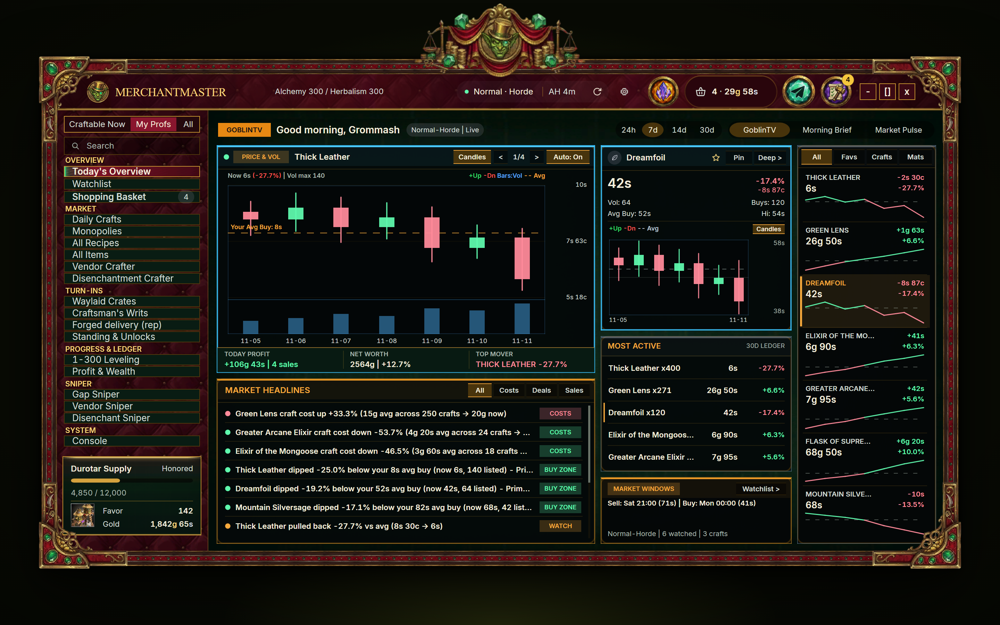

*   Personalized with your character's full WoW Forever name (`First Surname`) and an identical upper-right **GoblinTV | Morning Brief | Market Pulse** switcher across all three Today's Overview views.
*   Side-by-side **Profit** and **Hourly / Daily Wealth** charts with `24h`, `7d`, `14d`, and `30d` range selectors.
*   Strict `AH_SELL` KPI cards paired with a scrollable recent Auction House sales feed.
*   **Reagent Price-Drop Alerts** flagging reagents for your top crafts that dropped 10% or more below their 7-day baseline (Left-click for the recipe, Right-click for the reagent, Shift-click to add to cart).
*   Automatic wide-window scaling (`2240x1300`) on 1440p displays while preserving standard 1080p dimensions.

### 2. Daily Crafts (`Profit Spread`)
Plan your daily crafting batch by combining unit profit with how fast each item actually moves on your server.


*   Ranks profitable crafts by estimated daily gold income (`Profit x Sales/Day`) rather than theoretical unit profit alone.
*   Separates recipes you already know (on this character or across all alts) from unlearned opportunities.
*   Queue multiple daily crafts straight into the shared Shopping List in one click.

### 3. Waylaid Crates
Compare every Waylaid Supply Crate side by side to find the cheapest gold cost per **Merchant's Favor** token.


*   Covers all `30` Waylaid Crates across `96` material bundles.
*   Automatically deducts the turn-in coin reward when computing **Price / Token**.
*   Switch between `Best (Craft/Buy)`, `Craft Only`, and `Buy AH Only` modes and queue turn-ins straight to the Shopping List.

### 4. Craftsman's Writs (Reputation Writs)
Evaluate all `150` profession work orders by exact copper per reputation point before buying a single mat.


*   Accounts for **+75** (Journeyman), **+125** (Expert), and **+200** (Artisan) reputation rewards with *Azeroth Commerce Authority* and *Durotar Supply and Logistics*.
*   Factors **Coin Pouch** cashback (`35s 36c` / `74s 80c`) directly into net **Price / Rep**.
*   Supports turn-in zone filtering (`/mm area <zone>`) and multi-writ shopping queues.

### 5. 1-300 Profession Leveling
Generate a live, cost-sorted path from skill 1 to 300 without relying on stale static guides.


*   Recalculates recipe costs from your live AH scan and vendor prices across Yellow, Green, and Gray skill thresholds.
*   Includes Smart Mode to weigh resale value and daily sales speed against raw leveling cost.
*   Sends the entire shopping list for a skill bracket directly to the AH buyer and Crafter Helper.

### 6. Profit & Wealth Ledger
Track realized profit, net worth across characters, and per-item trade history without external spreadsheets.


*   Logs AH sales, buyouts, deposits, vendor trades, and crafting costs per WoW Forever `<Ruleset>-<Faction>` economy.
*   Tracks gold and inventory value across bags, bank, mail, and alts (with full WoW Forever `First Surname` support).
*   Filters by period (`Today`, `3 Days`, `7 Days`, `14 Days`, `30 Days`, `All`) and drills down into per-item profit and sale rate.

### 7. Shopping List & Sub-Craft Breakdown
A detachable shopping cart shared across Crates, Writs, Recipes, Leveling, and Watchlist views.


*   Expands recipes into raw materials and lets you toggle each intermediate reagent between **CRAFT** and **BUY AH** (or **Auto**).
*   Separates items you already own (bags, bank, mail, alts) from vendor pickups and Auction House buys.
*   One click sends the AH portion straight to the **Buy Auction House Helper**.

### 8. Visual Deep Analysis
Right-click any row or click **Deep Analysis >** in Quick Look for a full visual breakdown of a recipe, item, crate, writ, or reagent.

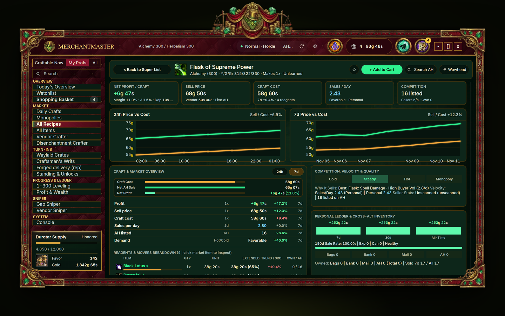

*   Dual `24h` and `7d` price and craft-cost trend charts (collapsing cleanly to a Vendor Floor / Live AH / 24h Deposit strip when fewer than 2 scans exist).
*   3-bar **Profit Waterfall** (`Craft Cost`, `Net AH Sale`, `Net Profit`) for recipes and a Price Range track for standalone items.
*   **Reagent Cost Share** percentage bars showing which material drives your cost, with click-to-drill-down and `< Return` history restoration.
*   Always-visible color-graded Hot/Cold sales heat strip right above the fold inside the **Competition** card: shows a `24h` hourly strip in Snapshot mode and a `Cold -> Hot` spectrum bar in Standalone or TSM mode.
*   4-tier **Demand Heat** bar, **Personal Ledger** horizon bars (including non-double-counted indirect disenchant profit), cross-alt stock chips (`Bags`, `Bank`, `Mail`, `AH`), a Watchlist star button in the header, and 7x24 heatmap timing when snapshots are enabled.

### 9. All Items & Quick Views
Browse and filter every cataloged crafting output, gathering material, cloth, recipe scroll, crate, writ, and vendor supply in one fast table.

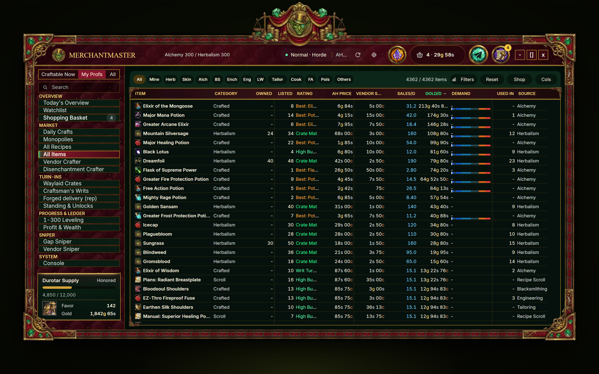

*   14 profession and category pills (`All`, `Mine`, `Herb`, `Skin`, `Alch`, `BS`, `Ench`, `Eng`, `LW`, `Tailor`, `Cook`, `FA`, `Pois`, `Others`) plus role, tradeability, demand, and skill filters.
*   Clean row separators, a light top filter card, customizable columns, and **Used In** counts showing how many recipes depend on a material.
*   Click any row for **Quick Look** (with favorite star toggle and `+ Add to Cart`), or Shift-click to queue immediately.

### 10. Favorites Watchlist
Pin the specific recipes and raw materials you trade every day so you can check them in seconds after an AH scan.

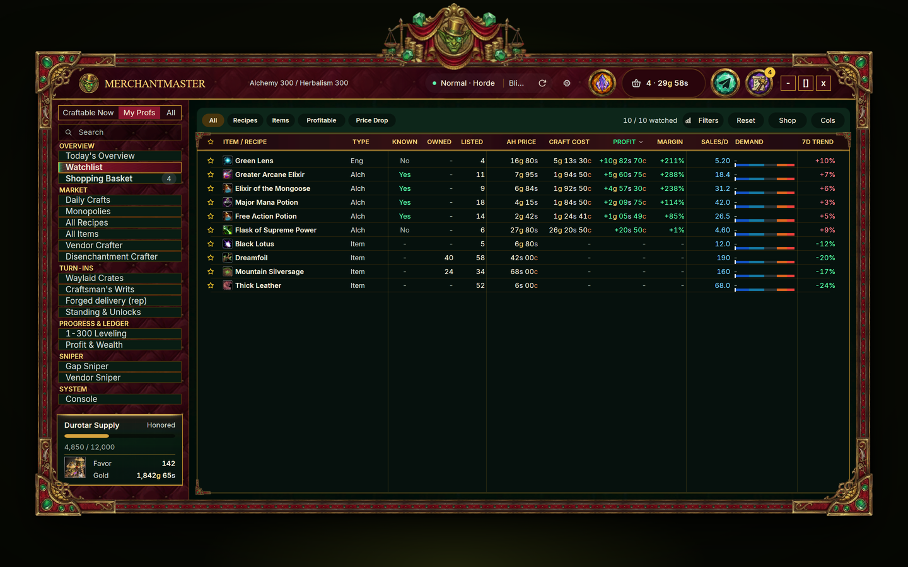

*   Combines starred crafting recipes and standalone items in one unified view (`/mm watchlist` or `/mm fav`).
*   Quick filter pills for `All`, `Recipes`, `Items`, `Profitable`, and `Price Drop` (10%+ below 7-day baseline).
*   Star buttons stay synced across Watchlist, Quick Look, and Deep Analysis, with inline 24h demand heat strips and `7d Trend` percentages.

### 11. Disenchant Helper & Enchanting Button
Turn bagfuls of crafted or looted gear into enchanting mats without hunting through bag slots.

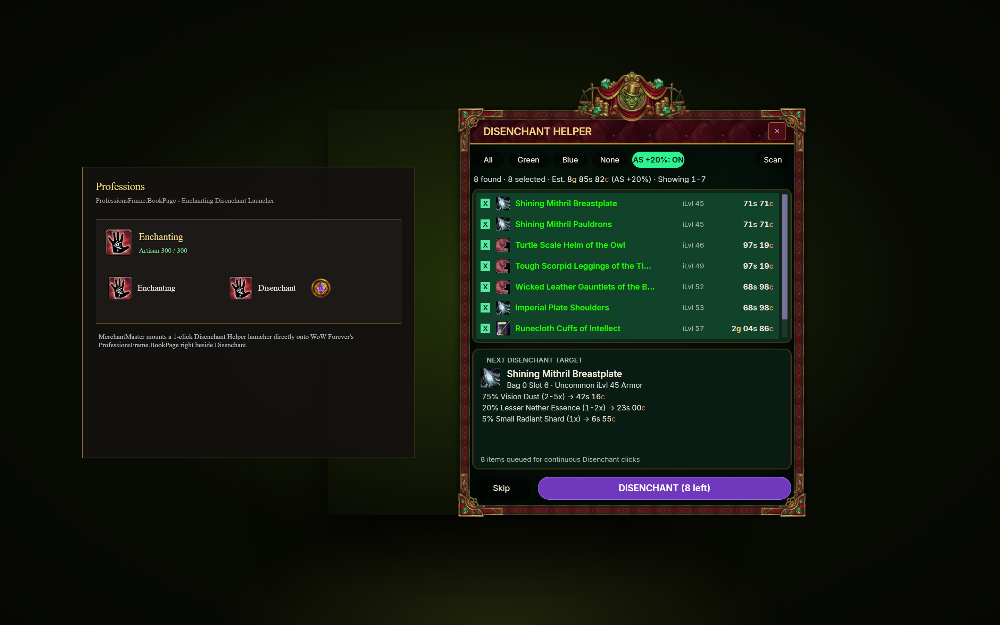

*   Scans bags for disenchantable Uncommon, Rare, and Epic items and displays expected material rolls and net value per item.
*   Toggle **Arcane Salvager (+20%)** and AH cut on the fly, check or uncheck specific items, or click **Skip** to pass over an item.
*   Repeatedly click one secure **DISENCHANT** button to process the list; launch it anytime via `/mm dehelper` or the button mounted on Blizzard's Enchanting Professions and Craft windows.

### 12. Crafter Helper
Move from shopping straight into crafting without losing track of sub-crafts or alt mats.

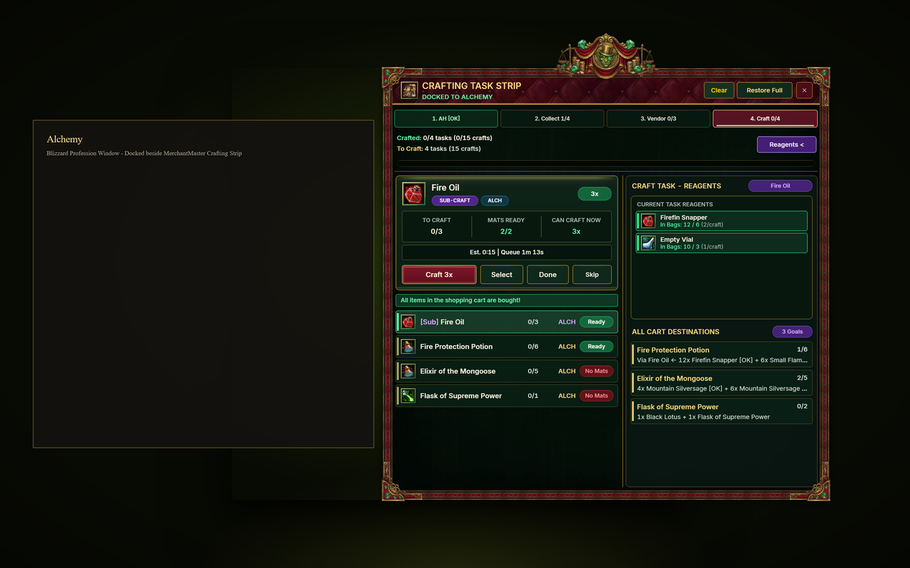

*   Guides multi-step orders through collect (`Bank`, `Mail`, `Alt`), vendor purchase, sub-craft, and final craft stages.
*   Includes a **Collect All** / **Stop** workflow to batch-loot needed crafting materials straight from your Bank and Mailbox.
*   Shows remaining quantities live as you withdraw materials and complete casts, keeping every craft tied to its parent Shopping List destination.

### 13. Mail Helper & Preset Recipients
Collect AH proceeds in batches and send mail between your characters without typos.

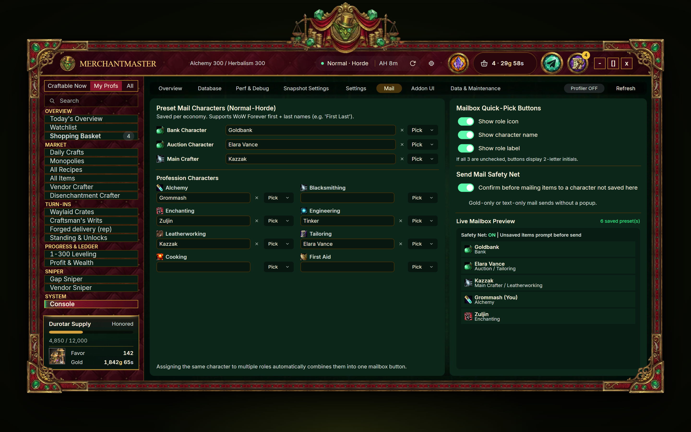

*   Uses a unified `280px` right-side dock alongside Blizzard's Mailbox across **Inbox** (`Mail Items`) and **Send Mail** (`Mail Recipients`), keeping Mail tabs unobstructed.
*   Categorizes your inbox inside the **Mail Items** dock (`All`, `Mats`, `Gear`, `Cons`, `Other`) and adds a top **Gold** row so you can collect mail gold even when your bags are full without touching item attachments.
*   Click any row to take a single stack (or gold from one letter), use per-row **Get All** / **Stop** to batch-loot matching items or gold while skipping C.O.D. mail, or click **Get All** inside Blizzard's **Open Mail** window to collect every attachment on an open letter; **Refresh** resets back to the ready summary automatically if the server does not respond.
*   Provides quick-pick **Mail Recipients** presets (`Bank`, `Auction`, `Main Crafter`, and profession alts) with a gear settings shortcut to **Console -> Mail** (`/mm mail`), a bounded `Saved:` pill, WoW Forever `First Surname` handling, and a confirmation prompt before mailing items to an unlisted character (gold-only mail keeps Blizzard's built-in confirmation).

### 14. Sell Helper (`MM Sell` AH Tab)
Post auctions from a spacious native tab built directly into the WoW Forever Auction House frame.

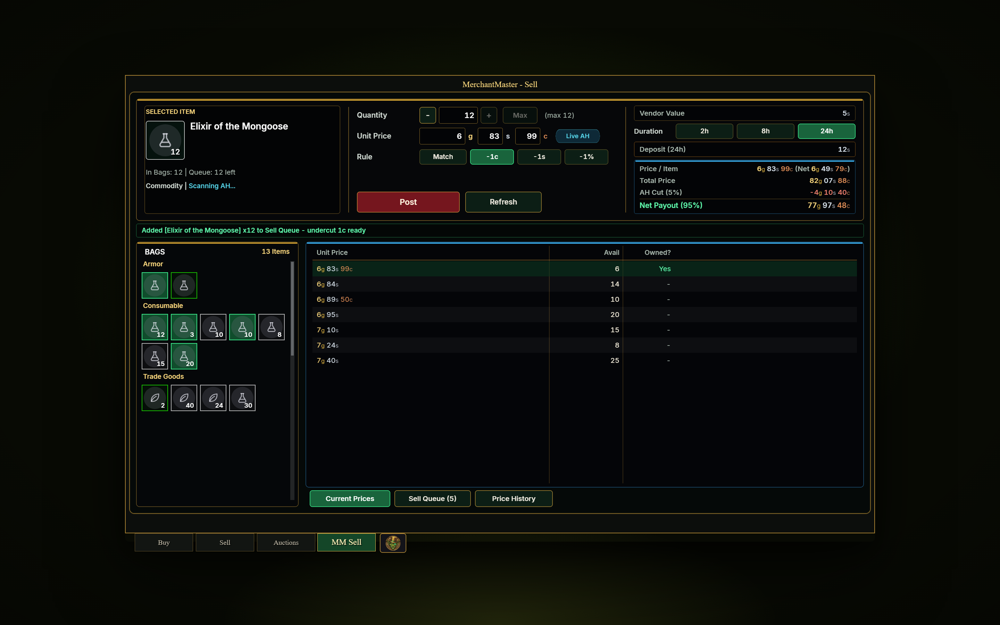

*   Automatically refreshes live AH prices whenever you open `MM Sell` or load an item, with guarded retry if the Auction House is throttled or busy.
*   Streamlines the 3-zone top workstation around **Post** and **Refresh** (with a context-only **Cancel** button shown only while confirming or posting), alongside larger `Deposit` and `Total Price` readouts, side-by-side `[Match] [-1c] [-1s] [-1%]` undercut rule buttons, and `2h` / `8h` / `24h` duration toggles.
*   Displays a live per-item **Vendor Value** readout and compares it against your 95% net AH payout after the 5% Auction House cut, showing a visual alert and a confirmation warning before posting if selling to an NPC vendor pays more.
*   Pairs a categorized bag grid with an Auctionator-style **Current Prices** table (`Buyout Price | Bid Price | Avail | iLvl | Owned?` for equipment and `Unit Price | Avail | Owned?` for commodities, with coin icons, column dividers, and auto-refresh after posting), recent price history, a Sell Queue, and lightweight scrollbars for smooth scrolling.

### 15. Buy Auction House Helper
Work through a multi-item Shopping List at the Auction House without typing item names one by one.

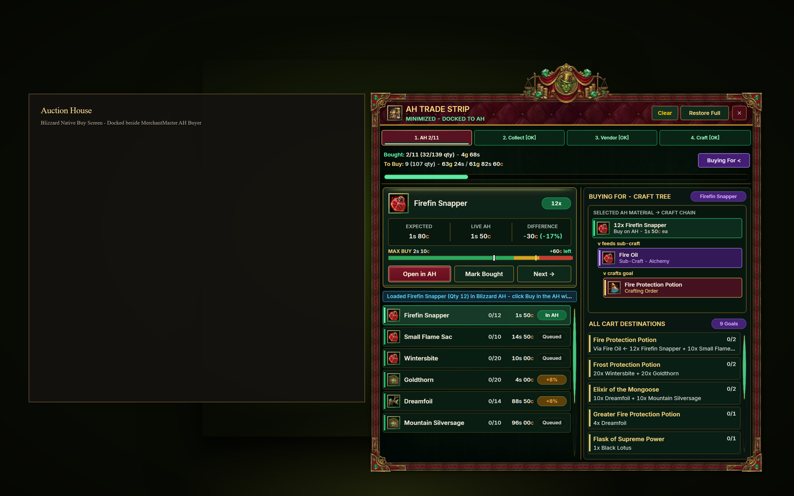

*   Selects and searches each queued item in turn, showing `Bought / Needed` progress, expected cost, live buyout price, and max-buy cap.
*   Displays a visual provenance chain (`Reagent -> Sub-Craft -> Goal`) for the selected item so you know why you are buying it.
*   Lets you filter the buying queue by specific destination goals when working on mixed orders.

### 16. Gap Sniper & Vendor Sniper
Spot mispriced auctions quickly after a scan, whether you want historical-gap flips or guaranteed vendor profit.

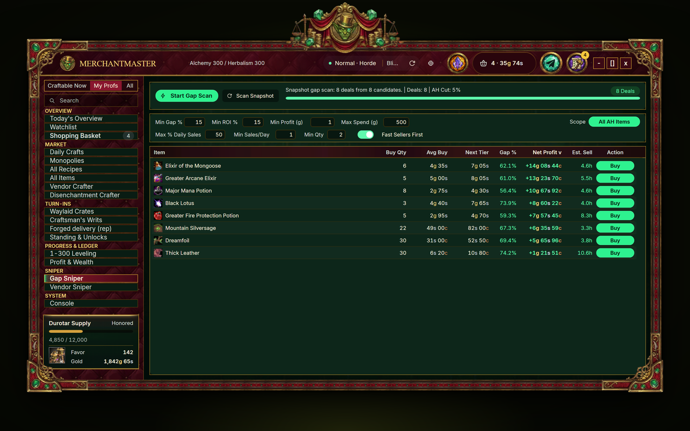

*   **Gap Sniper** filters across `All AH Items`, `Commodities`, or `Equipment` using configurable minimum gap %, ROI %, gold profit, daily sales, and max spend caps.
*   **Vendor Sniper** surfaces listings posted below NPC vendor sell price with configurable minimum profit.
*   **Disenchant Sniper** covers all `3,438` disenchantable WoW Forever DB2 weapons/armor (plus craftables and live `Browse` scaling synthesis) using **Scan All Equipment** (server-filtered Weapons + Armor in Uncommon/Rare/Epic) and a light O(1) Stage-1 EV pre-filter before Stage-2 Buy Moat calculation.
*   Synchronous click-to-buy workflow with live price ladders for WoW Forever compliance.

### 17. Console & Snapshot Settings
Inspect addon storage, switch themes, configure Mail presets, generate redacted bug reports, or set up optional background snapshots.

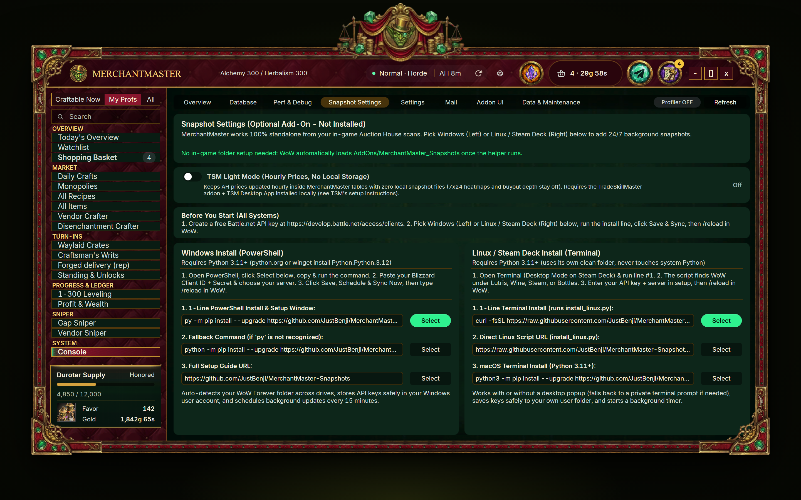

*   **Snapshot Settings (`/mm snapshots`):** Includes a mutually exclusive 3-way **Price Refresh Mode** selector (`Local Snapshot` | `TSM Light` | `None (Manual AH)`) alongside **Windows** (PowerShell), **Linux / Steam Deck** (`install_linux.py`), and **macOS** setup cards plus live database and WoW AddOn folder status. `Local Snapshot` and `TSM Light` are mutually exclusive: switching to **TSM Light** writes hourly refreshed prices into MerchantMaster's tables (requiring both the **TradeSkillMaster** addon and **TSM Desktop App** locally) while pausing local snapshot reads, 7x24 heatmaps, 24h hourly curves, and 6-tier buyout depth; switching to **None (Manual AH)** pauses both external feeds cleanly.
*   **Top Header Freshness Pill:** Displays the active market data source and age without clipping: `TSM <time>` (`TSM Light`), `Snap <time>` (`Local Snapshot`), or `AH <time>` (manual in-game scan), with the active refresh mode and timestamps shown on hover.
*   **Database (`/mm db`):** Inspects WoW SavedVariables alongside the dedicated **AH Snapshot Storage (On Disk)** card (`SQLite DB`, `WAL`, `SHM`, `Sync Log`, row counts, active DB path, and combined total).
*   Reports clearly if `MerchantMaster_Snapshots` is installed on disk but unchecked in **Esc -> AddOns**, with a manual **Refresh** button to retry loading.

---

## Themes & Typography

MerchantMaster defaults to **Goblin Baron** and includes five optional alternate themes: four Warcraft faction skins (`Human`, `Night Elf`, `Orc`, `Undead`) plus **Modern Glass** (Dark and Light). Every panel uses bundled static **Inter** fonts (`SIL OFL 1.1`) with automatic client-font fallback on non-Latin locales (`ruRU`, `koKR`, `zhCN`, `zhTW`). Switch themes anytime under **Console -> Addon UI** or with `/mm theme`.

---

## Installation

### Option 1: WowUp Hub (Recommended)
1. Open **WowUp** and select your **World of Warcraft Forever** (`_forever_`) installation.
2. Search for **MerchantMaster** and click **Install**.
3. Update through WowUp to keep your SavedVariables intact.

### Option 2: Manual Clean-Folder Install
1. Download the latest `MerchantMaster-*.zip` archive from [GitHub Releases](https://github.com/JustBenji/MerchantMaster/releases).
2. Extract it into `<WoW>\_forever_\Interface\AddOns\` so that `<WoW>\_forever_\Interface\AddOns\MerchantMaster\MerchantMaster.toc` exists (avoid nested `MerchantMaster\MerchantMaster\` folders).
3. **Upgrading from pre-`v3.3.0` builds:** Delete the old `Interface\AddOns\MerchantMaster` folder *before* extracting the new zip so removed legacy files do not remain on disk. Your settings and ledger in `WTF\` SavedVariables are stored separately and stay safe.

---

## Quick Start (First-Time AH Scan)

On a fresh install, the top status capsule shows **No AH Scan Yet** and Today's Overview displays a dismissible onboarding card:

1. **Run Scan #1 at the Auction House:** Talk to any Auctioneer and click **Scan AH** (or run `/mm scan` with the AH open) to record live buyout prices and listed quantities.
2. **Run Scan #2 (15+ minutes later):** Run a second scan at least 15 minutes after the first. Two timed scans give MerchantMaster local baseline prices and **Sales / Day** velocity for **Profit Spread** daily craft plans and **Gap Sniper** shortlists.

---

## Optional: Automatic AH Snapshots & 7x24 Heatmaps

MerchantMaster works 100% standalone from in-game Auction House scans. If you also want automatic Auction House updates, 30 days of price history, 7x24 demand heatmaps, and 7-day sales speed while WoW is closed, install the free optional companion [JustBenji/MerchantMaster-Snapshots](https://github.com/JustBenji/MerchantMaster-Snapshots) (**no Battle.net API key required**).

You can copy the exact command for your OS anytime inside WoW under **Console -> Snapshot Sync** (`/mm snapshots`):

*   **Windows (PowerShell, Python 3.11+):**
    ```powershell
    py -m pip install --upgrade https://github.com/JustBenji/MerchantMaster-Snapshots/archive/refs/heads/main.zip; py -m snapshot_builder configure --sync-mode github --apply-task --sync-now
    ```
    *(If Windows says `py` is not recognized, replace both `py` words with `python`.)*
*   **Linux & Steam Deck (Terminal, Python 3.11+):**
    ```bash
    curl -fsSL https://raw.githubusercontent.com/JustBenji/MerchantMaster-Snapshots/main/install_linux.py -o install_linux.py && python3 install_linux.py --sync-mode github
    ```
    You can inspect or download [`install_linux.py`](https://raw.githubusercontent.com/JustBenji/MerchantMaster-Snapshots/main/install_linux.py) directly. It creates its own isolated virtualenv under `~/.local/share/merchantmaster-snapshots`, locates your Wine/Lutris/Steam Deck/Bottles WoW `_forever_\Interface\AddOns` folder, pulls the GitHub snapshot bundle, and enables a `systemd --user` timer (or cron fallback).
*   **macOS (Terminal, Python 3.11+):**
    ```bash
    python3 -m pip install --upgrade https://github.com/JustBenji/MerchantMaster-Snapshots/archive/refs/heads/main.zip && python3 -m snapshot_builder configure --sync-mode github --apply-task --sync-now
    ```
*   **Preview / Rebuild / Turn Off:**
    *   Preview pending deltas: `py -m snapshot_builder pull-github --check-only` (Linux: `~/.local/bin/mm-snapshots pull-github --check-only`)
    *   Force clean rebuild: `py -m snapshot_builder sync --source github --force` (Linux: `~/.local/bin/mm-snapshots sync --source github --force`)
    *   Turn off background sync: `py -m snapshot_builder uninstall-task` (Linux: `~/.local/bin/mm-snapshots uninstall-task`)
*   **Zero in-game folder config:** The sync helper verifies SHA256 checksums, ingests only missing hourly/daily deltas into local SQLite, and writes `MerchantMaster_Snapshots\SnapshotData.lua` straight into `<WoW>/_forever_/Interface/AddOns`. Run `/reload` in WoW after setup, and check active database paths and disk usage anytime under **Console -> Snapshot Sync** or **Console -> Database**.
*   **3-Way Price Refresh Mode (`Local Snapshot` | `TSM Light` | `None (Manual AH)`):** Under **Console -> Snapshot Sync** (`/mm snapshots`), choose one mutually exclusive background feed:
    *   **Local Snapshot:** Reads synced `MerchantMaster_Snapshots` pulls, 30-day price history, 7x24 heatmaps, 24h hourly curves, and 6-tier buyout depth (while keeping TSM off).
    *   **TSM Light:** Writes hourly refreshed prices straight into MerchantMaster's tables with zero local snapshot files, and cleanly pauses local snapshot reads, 7x24 heatmaps, 24h hourly curves, and 6-tier buyout depth. Requires both the **TradeSkillMaster** addon and the **TSM Desktop App** installed locally (follow TSM's setup instructions).
    *   **None (Manual AH):** Pauses both `Local Snapshot` and `TSM Light` so MerchantMaster uses only your in-game `/mm scan` data.
    *   In the top header, the freshness badge shows your active feed at a glance: `Snap <time>` for `Local Snapshot`, `TSM <time>` for `TSM Light`, and `AH <time>` for manual in-game scans (hovering shows the active refresh mode and timestamps).

---

## WoW Forever Economy Glossary

*   **Live AH & `MM Sell` Tab:** Stores current floor prices (`ahPrices`), a 72-hour scan ring buffer (`ahHistory`), and rolling daily buckets (`ahDaily`) per economy, paired with the integrated **MM Sell** Auction House tab for undercut posting and queue management.
*   **Merchant's Favors & Waylaid Crates:** Tradeable supply crates (`30` crates across `96` material bundles) turned in for **Merchant's Favor** tokens. **Price / Token** deducts the turn-in coin reward from total craft or buyout cost.
*   **Craftsman's Writs:** Profession work orders (`150` Writs) rewarding **+75** (Journeyman), **+125** (Expert), or **+200** (Artisan) Reputation with *Azeroth Commerce Authority* / *Durotar Supply and Logistics*. Net cost includes **Coin Pouch** cashback (`35s 36c` / `74s 80c`) and supports turn-in zone filtering and multi-buy queuing.
*   **Regional Unique Names:** WoW Forever's optional two-part surname system (`First Surname` via `RegionalUniqueNamesEnabled()`). MerchantMaster tracks full character keys across bags, bank, mail, alts, Mail Helper presets, and the Ledger, and masks them in redacted bug reports.
*   **Multi-Economy Splits:** Isolates prices, watchlist price lookups, mail presets, and scan histories per WoW Forever `<Ruleset>-<Faction>` pool (`Normal`, `PvP`, `Roleplay`, `Roleplay PvP`, `Hardcore` x `Horde` / `Alliance`).

---

## Slash Commands

Aliases: `/mm`, `/merchantmaster`, `/crates`, `/waylaid`

| Command | Action |
|---|---|
| `/mm` | Toggle the main MerchantMaster window |
| `/mm help` | Print the public command list in chat (also `/mm ?`) |
| `/mm dashboard` | Open **Today's Overview** (Morning Brief & Hourly Wealth) |
| `/mm watchlist` | Open **Favorites Watchlist** (also `/mm fav`, `/mm favorites`) |
| `/mm spread` | Open **Daily Crafts (Profit Spread)** |
| `/mm recipes` | Open **All Recipes** (also `/mm known` to toggle Known Recipes Only) |
| `/mm items` | Open **All Items** & Quick Views (also `/mm allitems`) |
| `/mm crates` | Open **Waylaid Crates** (also `/mm favor`) |
| `/mm writs` | Open **Craftsman's Writs** (also `/mm area <zone>` to filter turn-in area) |
| `/mm vendor` | Open **Vendor Crafter** (also `/mm vc`) |
| `/mm decraft` | Open **Disenchantment Crafter** (also `/mm dc`) |
| `/mm dehelper` | Toggle the standalone **Disenchant Helper** window (also `/mm deh`) |
| `/mm sniper` | Open **Gap Sniper** (`/mm vsniper` for **Vendor Sniper**) |
| `/mm prof` | Open **1-300 Profession Leveling** planner |
| `/mm analytics` | Open **Profit & Wealth** ledger (`/mm ledger`, `/mm portfolio`) |
| `/mm shopping` | Toggle the detachable **Shopping List** window (also `/mm shop`) |
| `/mm sell` | Select the **MM Sell** tab while at the Auction House |
| `/mm mail` | Open **Console -> Mail** (Preset Recipients & send safety net) |
| `/mm snapshots` | Open **Console -> Snapshot Settings** (optional background helper setup) |
| `/mm db` | Open **Console -> Database** (SavedVariables & disk snapshot storage) |
| `/mm console` | Open **Console** overview, diagnostics, and Debug Bundle tools |
| `/mm options` | Open **Console -> Settings** (`/mm blizzoptions` for Blizzard Settings) |
| `/mm theme <name>` | Switch theme (`goblin`, `human`, `night_elf`, `orc`, `undead`, `standard`) |
| `/mm scan` | Run a Live AH market scan at an Auctioneer (also `/mm refresh`) |
| `/mm clearah` | Clear saved Live AH scan prices for the current economy |

Additional toggles: `/mm outliers` (Monopolies), `/mm forged` (Forged Delivery), `/mm rep` (Standing & Unlocks), `/mm calc` (Favor/Rep Calculators), `/mm allchars` (Craftable across all characters), `/mm econ` (cycle economy), `/mm cratetooltips`, `/mm crafttooltips`, `/mm detooltips`, `/mm debreakdown`.

---

## Bug Reports & Debug Bundle Privacy

If you hit a bug, open **Console -> Perf & Debug** (`/mm perf`) and click **Generate Debug Bundle**.

*   **Privacy First:** **Redact Names** (`redactNames`) is enabled by default, masking character names and realm identifiers before you paste the bundle into a [GitHub Issue](https://github.com/JustBenji/MerchantMaster/issues).
*   Include your **WoW Forever (`16001`)** build and MerchantMaster version from the window header or debug bundle.

---

## License

Copyright (c) 2026 JustBenji. **All Rights Reserved.**

MerchantMaster's original Lua code, data tables, and original art are source-available in plain text in accordance with Blizzard Entertainment's World of Warcraft UI Add-On Development Policy: you are free to download, read, and use the addon for personal gameplay, without permission to redistribute, fork for redistribution, or create commercial derivatives.

Third-party libraries under `Libs/` and the `Inter` font under `Assets/fonts/` retain their own respective licenses (Public Domain, BSD 3-Clause, and SIL OFL 1.1). See [`LICENSE`](LICENSE) and [`THIRD_PARTY_LICENSES.md`](THIRD_PARTY_LICENSES.md) for full details.
