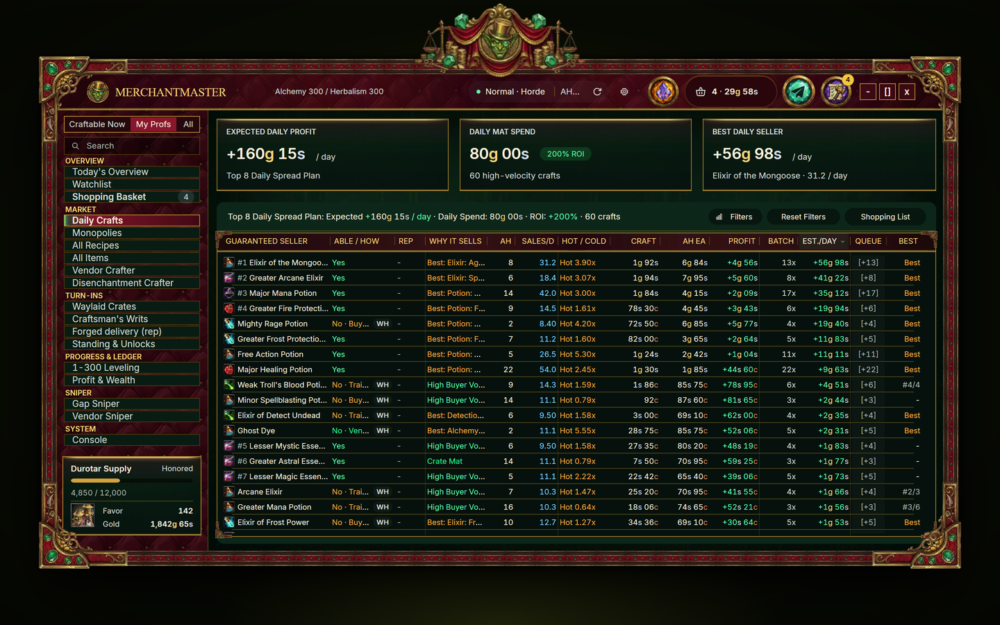
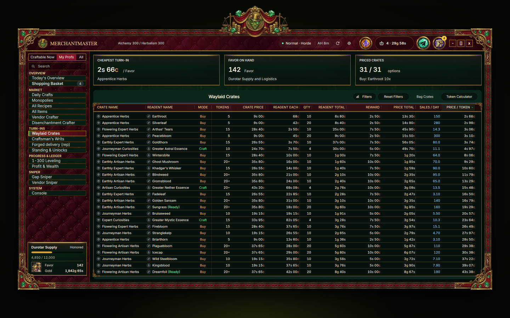
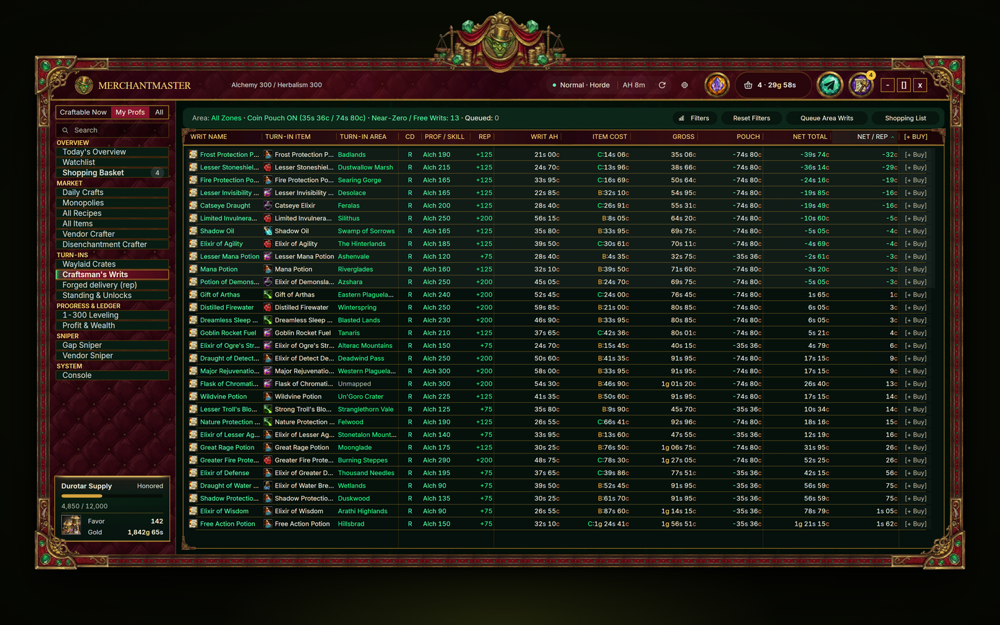
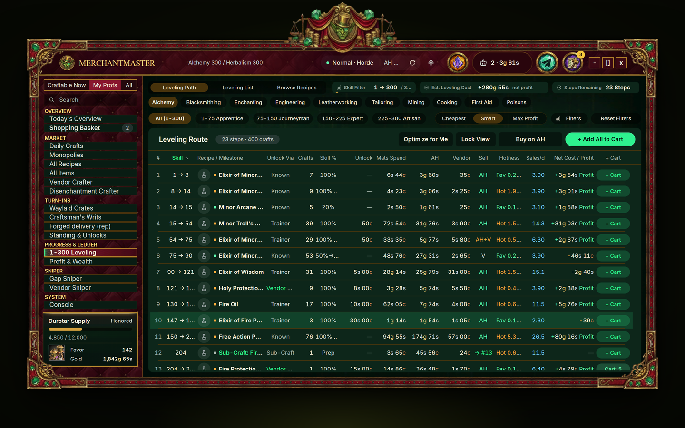
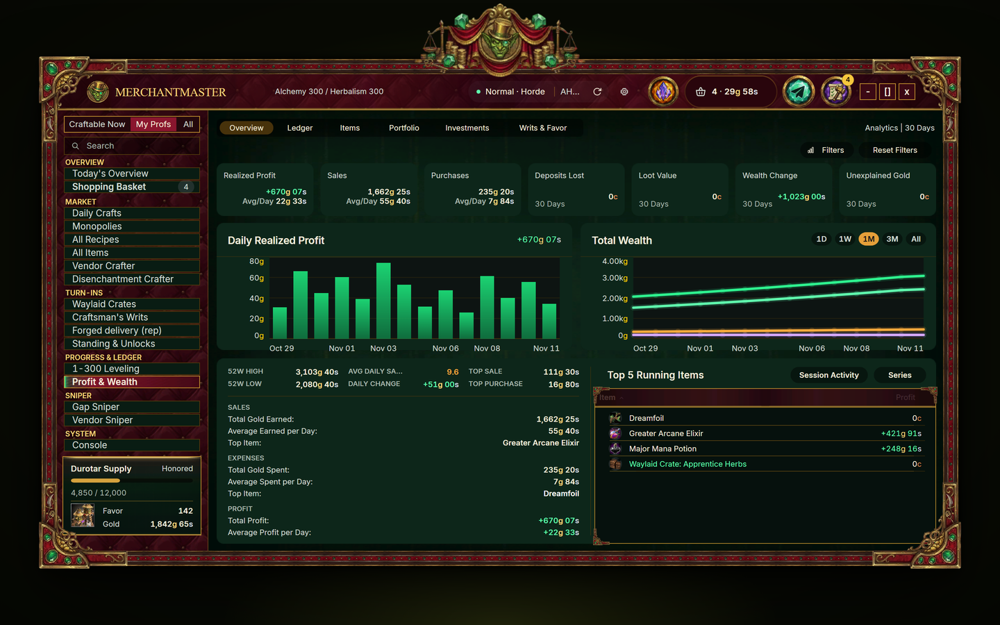
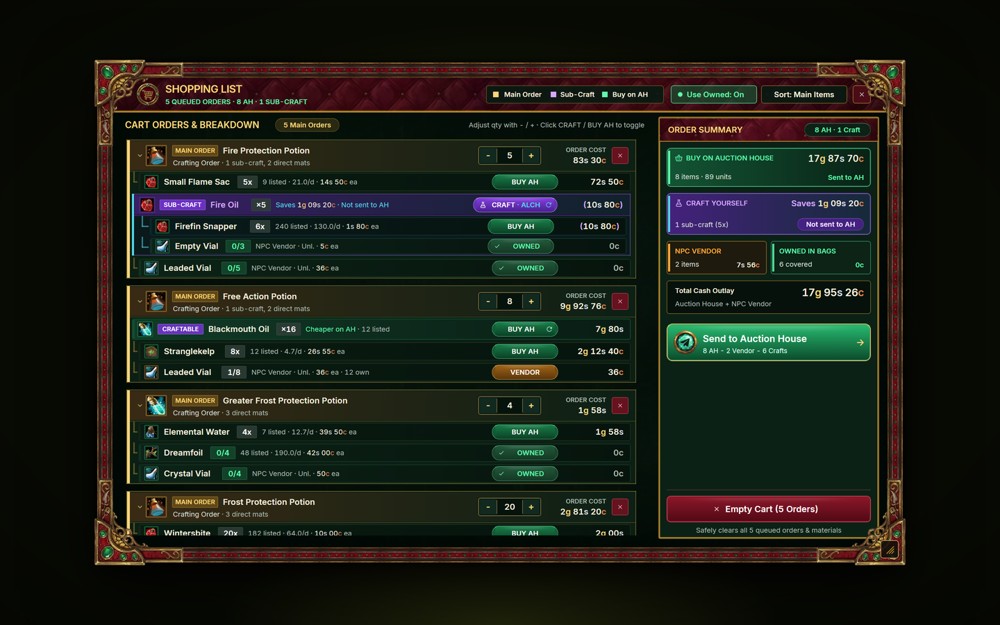

# MerchantMaster

**Standalone crafting, Auction House, ledger, and profession-leveling suite for World of Warcraft Forever (`Interface: 16001`).**

MerchantMaster analyzes live Auction House scans directly inside World of Warcraft Forever with zero external apps or companion dependencies required. Track daily craft profits, identify low-supply monopolies, optimize Merchant's Favor tokens and Craftsman's Writs, post auctions from an integrated **MM Sell** tab, plan 1-300 profession leveling routes, and track character gold and inventory in a clean ledger.


---

## Themes & Typography

MerchantMaster ships with **Goblin Baron** as the default theme and signature look, plus extra optional themes—4 Warcraft faction skins (`Human`, `Night Elf`, `Orc`, `Undead`) and **Modern Glass** (Dark and Light clean UI)—all rendered with bundled static **Inter** typography (`SIL OFL 1.1`) and automatic client-font fallback on non-Latin locales (`ruRU`, `koKR`, `zhCN`, `zhTW`). Switch themes any time from **Console -> Addon UI** or `/mm theme`.

---

## Screenshots (Goblin Baron)

### Daily Crafts (`Profit Spread`)


### Waylaid Crates


### Craftsman's Writs


### 1-300 Profession Leveling


### Profit & Wealth Ledger


### Shopping List & Sub-Craft Breakdown


---

## Installation

### Option 1: WowUp Hub (Recommended)
1. Open **WowUp** and select your **World of Warcraft Forever** (`_forever_`) installation.
2. Search for **MerchantMaster** and click **Install**.
3. Use WowUp to apply updates cleanly while keeping your SavedVariables intact.

### Option 2: Manual Clean-Folder Install
1. Download the latest `MerchantMaster-*.zip` archive from the [GitHub Releases](https://github.com/JustBenji/MerchantMaster/releases) page.
2. Extract the archive into `<WoW>\_forever_\Interface\AddOns\` so that the path `<WoW>\_forever_\Interface\AddOns\MerchantMaster\MerchantMaster.toc` exists (avoid nested `MerchantMaster\MerchantMaster\` folders).
3. **Upgrading from older pre-`v3.3.0` builds:** Delete the old `Interface\AddOns\MerchantMaster` folder *before* extracting the new zip so removed legacy files do not remain on disk. Your settings and ledgers in `WTF\` SavedVariables are stored separately and remain safe.

---

## Quick Start (First-Time AH Scan)

On a fresh install, the top status capsule displays **No AH Scan Yet** and the Dashboard shows a dismissible onboarding card:

1. **Run Scan #1 at the Auction House:** Visit any Auctioneer and click **Scan AH** (or run `/mm scan` with the AH open) to populate live buyout prices and listed quantities.
2. **Run Scan #2 (15+ minutes later):** Run a second scan at least 15 minutes after your first scan. Two timed snapshots allow MerchantMaster to calculate local baseline prices and **Sales / Day** velocity for **Profit Spread** daily income plans and **Gap Sniper** deal shortlists.

---

## Optional: Automatic AH Snapshots & 7x24 Heatmaps

MerchantMaster runs 100% standalone from live in-game scans. If you also want automatic 15-minute Blizzard Auction House snapshots, a 30-day local market database, 7x24 heatmaps, and 7-day sales velocity running in the background while WoW is closed, install the separate lightweight companion [JustBenji/MerchantMaster-Snapshots](https://github.com/JustBenji/MerchantMaster-Snapshots) (pure Python stdlib, zero executables, zero files added to the WowUp addon `.zip`):

*   **Requirements:** **Python 3.11+** ([python.org/downloads](https://www.python.org/downloads/) or `winget install Python.Python.3.12`) and a free [Battle.net API key](https://develop.battle.net/access/clients).
*   **1-Line PowerShell Install & Setup GUI:**
    ```powershell
    py -m pip install --upgrade https://github.com/JustBenji/MerchantMaster-Snapshots/archive/refs/heads/main.zip; py -m snapshot_builder setup-gui
    ```
    *(If `py` is not recognized, replace both `py` with `python`.)*
*   **Zero In-Game Folder Setup:** The Setup GUI auto-detects `<WoW>\_forever_\Interface\AddOns` (or lets you click **Browse...**), writes the sibling `MerchantMaster_Snapshots` addon automatically, and schedules background syncs—just enter your API key, choose your server, click **Save, Schedule & Sync Now**, and run `/reload` in WoW.

---

## WoW Forever Economy Glossary

*   **Live AH & `AH_SELL` (`MM Sell` Tab):** Captures current floor prices (`ahPrices`), a 72-hour scan ring buffer (`ahHistory`), and rolling daily buckets (`ahDaily`) per economy, paired with the integrated **MM Sell** Auction House tab for fast undercut posting, posting queues, and auction tracking.
*   **Merchant's Favors & Waylaid Crates:** Tradeable supply crates (`30` crates across `96` material bundles) turned in for **Merchant's Favor** tokens. **Price / Token** automatically deducts the turn-in coin reward from total craft/AH cost.
*   **Craftsman's Writs:** Profession work orders (`150` Writs) rewarding **+75** (Journeyman), **+125** (Expert), or **+200** (Artisan) Reputation with *Azeroth Commerce Authority* / *Durotar Supply and Logistics*. MerchantMaster factors **Coin Pouch** cashback (`35s 36c` / `74s 80c`) into net costs and supports turn-in area filtering and multi-buy queuing.
*   **Regional Unique Names:** WoW Forever's optional two-part surname system (`First Surname` via `RegionalUniqueNamesEnabled()`). MerchantMaster tracks full character keys accurately across bags, mail, bank, alts, and the Accounting Ledger, and masks them when generating redacted bug reports.
*   **Multi-Economy Splits:** Isolates prices and scan histories per WoW Forever `<Ruleset>-<Faction>` pool (`Normal`, `PvP`, `Roleplay`, `Roleplay PvP`, `Hardcore` x `Horde` / `Alliance`).

---

## Slash Commands

Aliases: `/mm`, `/merchantmaster`, `/crates`, `/waylaid`

| Command | Action |
|---|---|
| `/mm` | Toggle the main MerchantMaster window |
| `/mm help` | Print the public command list in chat (also `/mm ?`) |
| `/mm dashboard` | Open the Executive Profit Dashboard |
| `/mm spread` | Open **Make Profit -> Profit Spread** daily crafting plan |
| `/mm sniper` | Open **Gap Sniper** (also `/mm vsniper` for Vendor Sniper) |
| `/mm prof` | Open **Professor** 1-300 profession leveling planner |
| `/mm analytics` | Open **Analytics** ledger, portfolio, and item performance |
| `/mm shopping` | Toggle the detachable Shopping List window (`/mm shop`) |
| `/mm options` | Open **Console -> Settings** (or `/mm blizzoptions` for WoW Settings) |
| `/mm console` | Open **Console** overview, diagnostics, and Debug Bundle tools |
| `/mm scan` | Run a Live AH market scan (`/mm refresh`) |
| `/mm clearah` | Clear saved Live AH scan prices for the current economy |

Additional UI & feature toggles: `/mm theme <goblin | human | night_elf | orc | undead | standard>`, `/mm crates`, `/mm writs`, `/mm recipes`, `/mm known`, `/mm sell` (while at the Auction House).

---

## Bug Reports & Debug Bundle Privacy

If you hit an issue, open **Console -> Perf & Debug** (`/mm console`, then click **Perf & Debug**) and click **Generate Debug Bundle**.

*   **Privacy First:** The **Redact Names** option (`redactNames`) is **enabled by default**, automatically masking your character names and realm identifiers before you copy the bundle into a [GitHub Issue](https://github.com/JustBenji/MerchantMaster/issues).
*   Include your **WoW Forever (`16001`)** build and MerchantMaster version shown in the window header or debug bundle.

---

## License

Copyright (c) 2026 JustBenji. **All Rights Reserved.**

MerchantMaster's original Lua code, data tables, and original art are source-available in plain text in accordance with Blizzard Entertainment's World of Warcraft UI Add-On Development Policy: you are free to download, read, and use the addon for personal gameplay, without permission to redistribute, fork for redistribution, or create commercial derivatives.

Third-party libraries under `Libs/` and the `Inter` font under `Assets/fonts/` retain their own respective licenses (Public Domain, BSD 3-Clause, and SIL OFL 1.1). See [`LICENSE`](LICENSE) and [`THIRD_PARTY_LICENSES.md`](THIRD_PARTY_LICENSES.md) for full details.
